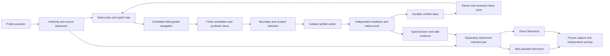

# Bounded architecture

The original Competition Dashboard connects one public question to scoped native realization and, only when authorized, two matched independent model requests. Safe public projections expose actual evidence/status, not private authority stores.

Only the assisted lane receives task-derived native context. Baseline receives the same public question/output contract without that context. Keys and evaluator truth are excluded from provider inputs; evaluator data is isolated from generators. Native-serialized answers and raw model answers retain distinct producer attribution.

Copied native contracts provide bounded mapping, Flower centers, finite QPRE, symbolic perspective/common-provenance representations and verified return. Candidate3D field/metric geometry and traversal policies are explicit engineering conventions. They do not supply missing canonical polarity/coupling or physical laws. Full-form T/P, stochastic expected utility, universal total-state/generative/inverse operators remain underdefined; a named trace is not execution evidence.

The older owner-selected expression and source-exact composition/recurrence/integral remain separate exact references. Canonical adoption is optional for candidly labelled engineering. Artifact materialization observes a genuine local effect while copying verified conditional knowledge; it does not create new real-world truth or alter production identity/authority.
